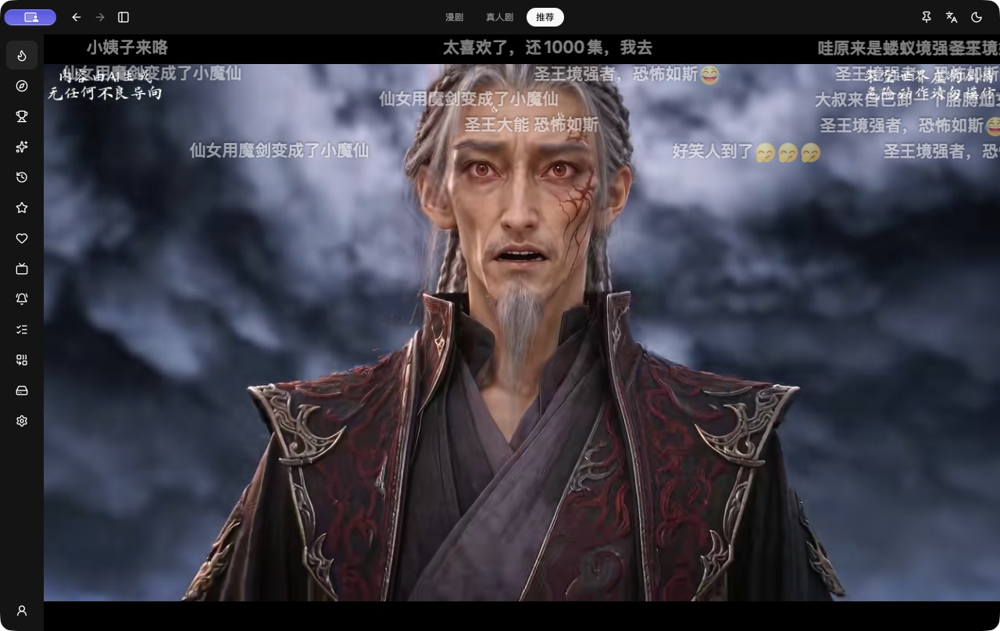
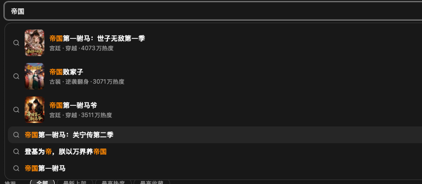

# guava · 番果

guava (番果) is an unofficial Hongguo client built with NSH 0.6.0 and Rust. Desktop targets are Windows 10 1809+, Windows 11 and macOS; Android and iOS have dedicated hosts.

[中文](README.md) · [Notice](NOTICE) · [Third-party notices](THIRD-PARTY-NOTICES.md)

For noncommercial learning and research only. This project is unaffiliated with the official service and does not store or distribute media. Read [NOTICE](NOTICE) and [LICENSE](LICENSE).

## The new desktop client

Version `0.7.0` uses native NSH views and a Rust application core. Desktop targets are Windows 10 1809+, Windows 11 and macOS 14+, with Chinese/English localization and light/dark themes.

| Feature                  | Available controls                                                                                               |
| ------------------------ | ---------------------------------------------------------------------------------------------------------------- |
| Immersive feed           | Recommended, animated and live-action channels, episode navigation and history-based resume                      |
| Discovery and search     | Categories, rankings, new releases and suggestions; media results open details, keyword suggestions run a search |
| Playback                 | Episodes, speed, quality, fullscreen, mini player, portrait, always-on-top and borderless windows                |
| Comments and interaction | Danmaku with emoji, comments, likes, favorites, follows and reservations                                         |
| Local media              | Download queue, personal library, merging and disk cleanup                                                       |
| Desktop integration      | System tray, boss key, shortcuts and exit confirmation                                                           |

Progressive media caching and prefetch use server-provided time windows, item counts and byte limits. Current playback takes priority; peak-hour policy may disable prefetch. A cache hit alone does not guarantee instant presentation for every source.

## Screenshots

These are real desktop screenshots. The search capture comes from feedback during this development round; the playback capture comes from the running local app.

**Immersive playback and danmaku**



**Media results and keyword suggestions**



## Download and installation

See [Releases](https://github.com/it00021hot/hongguo-desktop/releases). Windows packages include a Chinese installer and a portable ZIP. Apple Silicon and Intel Mac packages include separate DMG images and compressed archives. Open the DMG and drag the app into Applications.

The current version is `0.7.0`. Windows packages are not Authenticode signed; macOS packages are ad hoc signed without notarization. Windows N is unsupported.

## Development and packaging

Install Rust and platform SDKs. Build the pinned NSH CLI with the native-host integration patch, then add `target/nsh-cli/debug` to this terminal's PATH:

```sh
cargo build --manifest-path vendor/nsh/Cargo.toml -p nsh-cli --target-dir target/nsh-cli
nsh run crates/hongguo-nsh
nsh check crates/hongguo-nsh
nsh package crates/hongguo-nsh --target macos
```

Use `--target windows` on Windows; NSH generates an installer when Inno Setup is available. Mobile targets are `android`, `ios` and `ios-simulator`. App metadata and platform packaging options live in `crates/hongguo-nsh/nsh.json`.
Building, packaging, native SDK maintenance and release verification use the Rust tool in `tools/build` (`cargo build-tool <command>`) and do not require Node.js.
Formatting uses `cargo fmt -- --check`; shader maintenance uses `cargo build-tool enhancement-assets`. `make lint`, commit hooks and CI also require no Node.js/npm.
`make lint` checks the current host. The optional `make lint-macos` requires additional macOS Rust targets and a cross toolchain. Tools are located through PATH or environment variables without fixed installation directories.
Normal development verifies and extracts the bundled codec SDKs without building FFmpeg, VVdeC or libde265.
Customer packages include their codec libraries and do not install WebView2 or HEVC Store extensions.

Playback uses NSH Video, supplemented by libde265/VVdeC and native audio clocks. Extended Windows HEVC prefers D3D11 VLD with P010 for Main10; software decoding is the fallback. No FFmpeg is used.
See the [validation record](docs/nsh-decoder-validation.md) for actual platform coverage.

The application identifier is `com.guava.app`. Data lives in `%APPDATA%\guava` on Windows and `~/Library/Application Support/guava` on macOS, with database `guava.db`; `GUAVA_DATA_DIR` overrides the data root. Downloads use `guava/<series>` under the selected download root. Mobile hosts use private containers under the new application identifier. Previous data remains untouched and is not automatically migrated or deleted.

## Previous-version data

Version 0.6.x cannot automatically upgrade to 0.7.0 through the old app; download and install it manually from Releases. The 0.7.0 update checker reads GitHub release versions and opens the download page; it does not install updates automatically.

**0.7.0 does not migrate previous-version data automatically.** It starts with a separate database. Previous desktop versions using `hongguo.db` can be imported manually:

| Platform | Default old database | Default new database |
| --- | --- | --- |
| Windows | `%APPDATA%\hongguo-downloader\hongguo.db` | `%APPDATA%\guava\guava.db` |
| macOS | `~/Library/Application Support/hongguo-downloader/hongguo.db` | `~/Library/Application Support/guava/guava.db` |

1. Fully quit both versions, including tray processes, and back up both data directories.
2. Create the new directory if necessary. Move its existing `guava.db` and associated journal files into the backup location.
3. **Copy** the old `hongguo.db` into the new directory as `guava.db`. If `hongguo.db-wal`, `hongguo.db-shm` or `hongguo.db-journal` remain after shutdown, copy them together with the database and rename them to `guava.db-wal`, `guava.db-shm` and `guava.db-journal`. Do not mix old and new journal files or copy only the database while either app is running.
4. Start 0.7.0 and check your records and settings. This replaces the new database; it **does not merge** the databases. Keep the original and backups.

Use your actual directories if customized; 0.7.0 uses `GUAVA_DATA_DIR`. Database copying does not move downloaded videos or caches, so their original paths must remain accessible. These steps apply to desktop databases, not mobile private containers or earlier JSON data files.

## Project structure

Shared icons, emoji and translations live in `assets/`. Feature pages and presentation live in `src/features/`, shared controls in `src/ui/`, and window/navigation composition in `src/shell/` inside `hongguo-nsh`.
Business requests go through `hongguo-service`; NSH has no direct API-client dependency. ByteVC2 decoding is unchanged.
The workspace contains 30 crates, including the build tool in `tools/build`: encoding contracts belong to media types, enhancement to video GPU, and HEVC parsing to the container layer.
Global shortcuts, system notifications, desktop window operations and translations use native NSH APIs; platform supplements cover capabilities the framework does not expose.
See [project structure](docs/project-structure.md) and the [NSH development guide](.agents/skills/hongguo-dev/references/nsh.md).
Desktop CI for `0.7.0` uses macOS runners and the pinned NSH CLI to build Windows x64, Apple Silicon and Intel macOS packages. Version tags publish releases after all checks, artifacts and checksums pass; manual runs keep a draft unless publication is selected. Windows is unsigned; macOS is ad hoc signed without notarization. Installation and playback still require validation on the respective devices; see the [desktop release guide](docs/desktop-release.md).
The Tauri/GPUI shells, their legacy players and the WebView frontend have been removed. Their complete backup is
[`codex/backup-tauri-final`](https://github.com/it00021hot/hongguo-desktop/tree/codex/backup-tauri-final).
Legacy versions are no longer maintained and receive no feature updates or bug fixes. Development and issue reports now target the NSH client.
