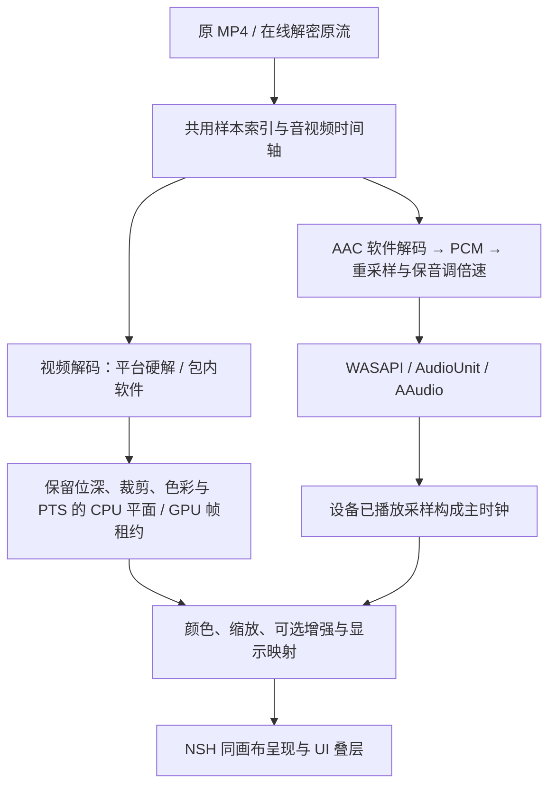

# NSH 0.5.0 解码、音频与呈现方案

状态：已批准并实施，2026-11-14。NSH/CLI 基于 0.5.0（`f4d68f7`）；新的包内解码、PCM 会话、平台硬解和高精度颜色路径已接入。代码和构建验证不代替真机发布验收，实际结果与剩余门槛见 [解码验证记录](nsh-decoder-validation.md)。

范围：新增能力只落 NSH 的 Windows、macOS、Android、iOS。Tauri 只维护实际问题，不打包 WebView2；GPUI/Tauri 的删除单独执行。播放继续读取原流，不恢复兼容转码、`.play.mp4`、grow 或 HLS 播放链。

English summary: Bundle software video and AAC decoding as the playback baseline. Prefer D3D11VA on the same device as NSH's Windows compositor; admit hardware paths only after stream-specific capability and quality checks. Preserve source precision through processing, add a complete PCM audio clock, and treat native HDR composition as a separate release requirement. Performance and energy claims require measurements of the complete playback pipeline.

## 1. 目标与确定的技术路线

优先级固定为：**安装后可用 → 格式能力、画面和声音正确 → 满足所选倍速与交互时延 → 在合格路径中优化能耗和资源占用。**

“最优”是有约束的选择：同片源、同画质、同倍速、同增强和显示条件下，先达到实时与首帧/seek 要求，再比较持续播放的整机能耗。不能用解码峰值 fps、丢位深、跳过滤波、降低片源或静默关增强替代这个目标。

推荐一套自有播放会话：现有 MP4/CENC 供数与索引，随包 FFmpeg 软件解码及平台硬解，ByteVC2 使用 VVdeC，音频统一解为 PCM，平台只承担输出设备和原生表面接入。



无音轨时使用可暂停、调速和跳转的单调时钟；有音轨但暂时欠载，不通过改用墙钟掩盖断音。

## 2. 库、编码与承诺范围

本次方案基线固定为 [FFmpeg 9.0.2](https://ffmpeg.org/download.html) 和 [VVdeC 3.2.1](https://github.com/fraunhoferhhi/vvdec/releases/tag/v3.2.1)。实施时锁源码、校验与构建选项，Rust 包版本和实际 C 解核版本分别记录。

| 内容 | 选择 | 承诺与限制 |
| --- | --- | --- |
| HEVC、已验证的 ByteVC1 | `libavcodec` HEVC 软件核；同一压缩样本接平台硬解 | 标准 HEVC 支持不证明所有 ByteVC1 私有变体；真实 ByteVC1 必须全分辨率对拍、连续播放及随机跳转 |
| ByteVC2 | 现有参数集/样本转换 + VVdeC 3.2.1 | 默认软件解码；标准 VVC 硬件支持不等于 ByteVC2 支持。新版 VVdeC 不承诺超过 10 位 |
| H.264 | 纳入解核能力目标，使用 `libavcodec` 原生软件核及同平台硬解 | 当前选流策略仍排除 H.264。实施时须连同规范和能力契约明确修订，不能悄悄开放，也不能恢复 H.264 兼容转码或降质选流 |
| AAC | `libavcodec` 原生软件解码 | 必验 AAC-LC、HE-AACv1/v2、实际 ASC、声道及输出采样率；`mp4a` 标签不能证明所有 Audio Object Type 可解 |
| 重采样、倍速 | `libswresample` + 精简 `libavfilter` 的 `atempo` | 音频格式、声道和设备采样率协商；1×旁路倍速滤镜 |
| MP4/CENC | 现有 `hongguo-video`、`hongguo-stream` 与供数 | 修复时间轴/索引缺口，不增加第二套网络、解密与容器状态 |

必带库为 `libavcodec`、`libavutil`、`libswresample`、精简 `libavfilter` 和 VVdeC。播放不需要外部 FFmpeg/ffprobe 可执行程序、编码器、x264/x265 或额外的 `libavformat` 网络栈；CPU 像素转换若确有需要再纳入 `libswscale`。

AV1/VP9、其他容器及全部音频变体不因 FFmpeg 有相关代码就成为本产品承诺；需要真实下发或明确产品需求，再纳入样本矩阵。现有红果样本和 APK 证据仍不足以宣布全片库格式已经穷尽。

已用仓库内 `hongguo-vvdec-sys` 替换旧 `vvdec 0.6.11 → vvdec-sys 0.7.0` 的 3.0.0 解核，固定源码为 **3.2.1**。绑定从同版本头文件生成，保留原位深平面、SAR、颜色和 HDR 元数据；发布包版本不取决于开发机的 Homebrew。旧壳的 I4208 端点仍是明确的兼容出口，NSH 读取新的原位深帧契约。

## 3. Windows 的明确选型

### 3.1 默认路线：libavcodec + 同设备 D3D11VA

[NSH 0.5 的 Windows 图形层](https://github.com/longbridge/nsh/blob/v0.5.0/crates/nsh-platform-windows/src/gfx.rs) 是 D3D11/Direct2D；[标准视频组件](https://github.com/longbridge/nsh/blob/v0.5.0/crates/nsh-platform-windows/src/native/video.rs) 使用 MediaEngine frame-server。本项目的增强才通过共享纹理进入 WGPU/D3D12，完成后返回 D3D11/Direct2D。现有增强往返没有 CPU 回读，但有 GPU 复制与同步。

MediaEngine 是高层播放引擎，D3D11VA 是底层硬解接口。新方案让 libavcodec 处理压缩解码与硬解提交，不再把系统 HEVC MFT 或 MediaEngine 当作视频能力的前提；音频也由包内解码器负责。

选 D3D11VA 的依据：

1. [FFmpeg 接受应用提供的 D3D11 设备](https://github.com/FFmpeg/FFmpeg/blob/n9.0.2/libavutil/hwcontext_d3d11va.h)，可以复用 NSH 实际绘制设备；解码、颜色处理与无增强呈现留在同一设备。
2. [D3D11VA 直接对接 D3D11/DXGI](https://github.com/FFmpeg/FFmpeg/blob/n9.0.2/libavutil/hwcontext_d3d11va.c)，不依赖安装商店 HEVC 解码扩展。具体编码、profile、位深和尺寸仍由 GPU/驱动决定，包内软件路径承担覆盖。
3. D3D12VA 没有已证实的全链路速度或能耗优势；FFmpeg 9.0.2 的[初始化还要求 DecodeTier ≥ 2](https://github.com/FFmpeg/FFmpeg/blob/n9.0.2/libavcodec/d3d12va_decode.c)。其自行创建设备路径请求 FL12_0，注入已有设备可避开这一步，不能把它说成 D3D12VA API 的统一最低要求。

| 候选 | 本方案定位 |
| --- | --- |
| D3D11VA | Windows 默认硬解实现，按真实流和驱动能力准入 |
| D3D12VA | 同样本、同质量的完整链路对照；只有证明改善能耗/时延且不缩窄承诺覆盖时，才据此调整发布策略 |
| MediaEngine / HEVC MFT | 不承担新方案的视频或音频解码保底 |
| 单独引入 NVDEC、QSV、Vulkan Video | 当前无覆盖或全链路收益证据，不增加平行驱动路线；后续只由明确能力缺口或测量推动 |

这是一条主线的验证顺序，不要求客户手动选后端，也不在客户机器长期同时运行多套解码器。

### 3.2 原画与增强的帧路径

- **硬解、无增强：** D3D11VA 的 NV12/P010 → D3D11 GPU 颜色与显示映射 → NSH 同画布合成。
- **软解、无增强：** 原位深 YUV 平面上传 → 相同语义的颜色/显示映射 → NSH 同画布合成。
- **开启增强：** 高精度 GPU 输入 → 现有 D3D11↔WGPU/D3D12 共享桥的高精度版本 → 增强 → 高精度共享输出 → NSH 合成。

关闭增强时不创建 WGPU/D3D12 增强设备，目标是避免增强处理及不必要的 GPU 唤醒；实际能耗仍以整机测量确认。颜色算法、系数、测试向量由一个公共模块定义；D3D11/WGPU 执行适配不得各维护一套不同色彩规则。

设备复用不意味着任意跨线程操作：D2D context 留在 UI 线程，codec context 由解码 worker 独占；D3D11 immediate/video context 遵守统一的多线程保护与提交规则。UI 不等待解码或 GPU 完成，锁不跨 await，也不在锁内回调 UI。

不能假定 decoder surface 兼容 shader 采样或跨 API 共享。优先直接消费；不满足绑定限制时允许必要的 **GPU 内复制**，避免 GPU→CPU→GPU 全帧往返；有复制就按实际计量，不宣称零拷贝。

默认让解码、增强与呈现使用同一适配器，校验 LUID。当前桥不支持任意跨显卡共享；跨卡不是默认恢复方法。若目标机器的同卡方案达不到承诺档位，必须在发布前验证替代数据路径，不能用峰值硬解性能推断其可行性。

### 3.3 8/10 位、SDR 与原生 HDR

**上游 NSH 0.5 的 BGRA8 合成不能直接承担原生 HDR。** 本仓库以 `vendor/nsh` 维护同一份固定源码，在 Windows 添加 FP16/scRGB 输出、显示能力协商，以及离屏层、缓存和 UI 线性合成。硬解/软解和增强共享高精度路径；Anime4K/锐化已去除最终 `[0,1]` 截断。是否对目标设备开放原生 HDR，仍由下述真机门槛决定。

完整方案必须分清三件事：

1. 解码和处理中保留源位深，10 位源不得在进入颜色/增强前截成 8 位。
2. SDR 显示链正确执行传递函数、色域与色调映射，最后按实际输出精度量化并抖动。8 位 SDR 显示设备上的最终量化，不等于允许提前丢失源精度。
3. 原生 HDR 需要同画布合成器的实际支持。推荐验证 [Windows Advanced Color 的 FP16/scRGB 输出](https://learn.microsoft.com/en-us/windows/win32/direct3darticles/high-dynamic-range)，连同交换链格式、色彩空间、显示能力、SDR UI 白电平、文本与弹幕合成一起实现。

第三项需要对固定 NSH 0.5 源码的合成输出做可审查扩展，包括所有可能承载视频的离屏层、缓存和中间合成目标，不能只替换最终交换链。优先形成上游能力，缺少接口时维护最小、可回收的同源补丁，所有 NSH crate 保持同一套来源。它是原生 HDR 的发布前置条件，不把“暂时转 SDR”冒充 HDR 完成。

不能另开一个盖住界面的 HDR 子 HWND 来绕过合成器：[NSH 的公开子窗口接口](https://github.com/longbridge/nsh/blob/v0.5.0/crates/nsh-platform-windows/src/native.rs) 明确使它位于所有 NSH 内容上方，会破坏控制栏和弹幕顺序。

## 4. 四端共享的软硬解策略

| 平台 | 默认加速候选 | 不满足要求时 |
| --- | --- | --- |
| Windows | 同 NSH 设备的 D3D11VA | 相同压缩流的 libavcodec 软件解码 |
| macOS / iOS | VideoToolbox，原生 CVPixelBuffer/IOSurface 进入 Metal | libavcodec 软件解码，上传原位深平面 |
| Android | MediaCodec，原生 Surface/缓冲进入验证过的 GPU 路径 | libavcodec 软件解码，保留源精度 |
| ByteVC2 | VVdeC 软件解码 | 明确错误；未证实兼容性前不尝试普通 VVC 硬解冒充支持 |

Apple 要读取实际硬件解码状态；Android MediaCodec 也可能选中系统软件组件，不能只按 API 名称统计为硬解。Android API 28 不能按新版接口或 codec 名称假定所有设备都有 10 位可用输出；opaque Surface、P010 导入、dataspace 和最终显示必须逐路径验证。

自动选择顺序：

1. 从真实参数集/轨道描述取得编码、profile、level、位深、采样、尺寸、时间信息与颜色。缓存的剧集标签只能辅助，不能代替真实码流。
2. 按设备/API 能力过滤，再用当前流真实参数创建解码器并验证输出格式、尺寸、PTS 及首个可显示帧。API 列出 HEVC 或“创建成功”都不算播放成功。
3. 在经过离线质量验收的硬解组合中优先选择默认平台路径；拒绝精度不够、已知错误或本会话失败的后端。
4. 包内软件解码始终存在，硬解不可用时直接用软件。硬解实际持续落后时，先区分供数、解码、颜色、增强和合成原因；只有解码后端是原因才更换它。
5. 质量、稳定性和目标倍速都合格后，使用真机测量形成的默认策略。换后端收益应超过测量波动和恢复成本，避免一会儿软解一会儿硬解。

客户不跑长时间校准，也不需要安装编解码包。首次创建和短期播放只收集当前路径的真实运行状态；产品侧的跨后端对照在测试机器完成。

若持久化能力结果，键至少覆盖库构建版本、OS/驱动、适配器、编码/profile、位深/采样、尺寸范围及输出路径；版本/驱动变化失效，容量有界。运行失败排除先限定在会话及实际出错的流参数，不能把网络错误或坏文件写成永久显卡黑名单。

## 5. 音频、时间轴与恢复

### 5.1 音频也必须安装后可用

```text
AAC 压缩样本 + 完整 ASC
  → libavcodec 软件解码
  → PCM 格式/声道/设备采样率协商（libswresample）
  → 保音调倍速（精简 libavfilter / atempo，1×旁路）
  → 有界 PCM 环
  → WASAPI / Core Audio AudioUnit / Android AAudio
```

覆盖当前 0.75、1、1.25、1.5、2、3×。`atempo` 单级限制在 0.5–2，3×用两级 `sqrt(3)`；[官方文档](https://ffmpeg.org/ffmpeg-filters.html#atempo)指出单级大于 2 会跳样。倍速听感、瞬态、声道相位与算法时延均需验收，不能仅证明能调用滤镜就宣布质量最优。

系统 AAC 不能当作无条件保底。例如 Windows N 的媒体组件并非默认齐全。更进一步，NSH 0.5 自带 Video 和 Sound/AudioPlayer 仍可达 Media Foundation 调用，且没有现成的 media feature：仅替换我们自己的 MediaEngine 不足以证明最终 EXE 摆脱 MF。

需在同一 NSH 源码中为不使用的系统媒体实现及其分派补齐门控。还要处理整个应用的依赖闭包：`hongguo-media-platform-windows` 的归档、转码与能力探测同样直接调用 MF。保留这些业务语义，但把可选 MF 能力改为显式、受控的动态装载和函数表；组件不存在时返回既有能力不足，不阻止应用启动或播放。

已在固定 NSH 源码补齐 media feature，并将本项目归档层的 MF 入口改为受控的 System32 可选装载；缺失时返回能力不足。新的 Windows EXE 和四个包内 DLL 已完成普通及 delay imports 的递归审计，没有强制 MF、动态 CRT 或 WebView2 依赖。无媒体功能包的干净 Windows 启动与播放仍需真机验证，静态导入检查不替代该门槛。

### 5.2 一个真实的主时钟

有声时使用输出设备实际消费的 PCM 帧映射回媒体 PTS，计入输出缓冲、重采样和倍速算法延迟；不能拿已解码或已入队采样数充当已播放时间。换速后排队音频可能仍属于旧速率，必须按 PCM 段保留映射，不能用“当前倍率 × 累计设备时间”粗算。

无音轨时使用单调时钟。暂停、seek、后台和音频欠载都显式更新时钟状态；设备播放补零不能被统计为媒体继续前进。设备切换、耳机拔插与移动端音频中断要重建输出并重新锚定，不能让恢复后的画面追赶错误时钟。

已实施的输出工作线程在播放时用 250ms 有界设备位置检查发现失联，稳定暂停后等待控制消息；重开前保留旧设备的最终实际消费位置，沿用共享恢复预算。初始起播与带音轨的新代次都等待视频呈现和音频就绪，格式/回调错误单独终止。该机制的注入回归已通过，真实设备切换仍按末节验收。

容器时间轴由唯一模块处理：有符号 PTS/DTS、time_base、完整 edit list、AAC priming、公共 movie origin、VFR、B 帧和尾帧时长。当前仅取首个非空 edit、按轨单独移动负 PTS 的做法需修复；更换 libavcodec 不会自动修好这些问题。

### 5.3 同源恢复状态机

会话至少区分 Opening、Playing、Paused、Buffering、Seeking、Recovering、Ended、Failed、Closed。当前 `DirectSession` 错误会进入终态，不能只在外面加一次 seek 就实现后端恢复。

硬解不支持或发生可恢复的后端错误时：

1. 冻结媒体时钟和音频推进，保持最后一个有效画面。
2. 递增 source/seek/decoder 代次，取消旧任务；旧回调和帧不能再提交。
3. 保持同一原流、同一档位、同一质量，从目标点之前有效 RAP 重建软件解码器；正确处理重排及 CRA/RASL 预滚。
4. 丢弃不再覆盖目标时间的旧输出，选择覆盖目标时间的帧（时间轴有间隙时按间隙语义处理），准备对应 PCM；新代首帧确认上屏后恢复时钟。
5. 当前会话按“后端 + device 代次 + 实际流参数”排除已失败候选，每个候选只尝试一次；设备重建或参数集变化形成新候选。软件也失败则进入可见错误，不无限软硬互切。

网络、解密、容器/码流损坏、解码器、增强和呈现故障分别归因。增强出错不伪装成解码失败，也不静默改变用户画质开关；需要继续原画时明确反映实际状态。GPU 设备丢失即使已转软解，也必须重建呈现设备、帧池、纹理和 fence，不能宣称 CPU 解码能修复 GPU 呈现。会话级恢复次数与耗时上限独立于 device 代次，不能靠反复重建设备重置预算。

## 6. 帧精度、所有权与可测的优化

### 6.1 替换固定 CPU BGRA8 契约

平台无关帧头至少保留：source/seek/device 代次、serial、原始 PTS/time_base、coded size、visible crop、旋转、SAR、像素格式、有效位深、每平面 stride/尺寸、色度位置、range/matrix/primaries/transfer 及 HDR 侧数据。

CPU payload 持有原位深平面；GPU payload 由平台适配器持有纹理/数组下标、解码帧引用、同步对象及释放规则，不把 UI 或平台实现类型泄漏给 service。软件和硬件产物进入同一颜色/呈现契约，但不强迫彼此转换到同一种物理内存形式。

帧租约直到 GPU 消费完才释放，不能收到下一帧就回收旧 decoder surface。每个 codec context 由单个 worker 拥有，完整实现 send/receive、EAGAIN、多帧输出与 EOF drain；压缩数据/extradata 使用 FFmpeg 定义的 padding 常量。

奇数可见宽高按真实 crop 表达，420 色度平面向上取整，不能用 `& !1` 丢边缘。参数集、动态尺寸及颜色变化要触发重配；容器与码流元数据保留来源，缺失信息使用明确且可诊断的显示假设，不能按高度猜值后当作真实 metadata。

### 6.2 颜色与增强

按源语义进行 range/矩阵转换、传递函数与色域转换，内部保留足够精度；显示映射与最后量化在正确位置执行。10 位不是 HDR，硬解 API 缺字段也不代表源没有字段，应从同源容器/参数集/SEI 可靠补齐。

锐化与 Anime4K 的工作空间、亮度归一和反变换要明确。现有 SDR `[0,1]` 模型不能直接作用于 HDR 绝对亮度后裁掉高光；HDR 安全版本通过测试之前，该组合不能纳入原生 HDR 承诺。关闭增强只关闭增强算法，不关闭必要的颜色处理与显示映射。

Apple 验证 Metal/EDR 与颜色空间；Android 验证原生缓冲、dataspace、同步和高位深显示表面。当前 8 位 SurfaceTexture 路径不能靠声明 P010 就扩大为所有 API 28 设备的 HDR 能力。

### 6.3 速度与能耗

- 软解直接上传 YUV，硬解保留 GPU 表面；按尺寸/格式复用帧池和纹理，消除每帧 BGRA 分配和 CPU 色彩转换。
- 解码、音频和 GPU 队列按时间与字节预算双重有界，背压贯穿供数；限制预解码领先量，不以跑满所有核心为目标。
- 只处理实际将呈现的帧；显示已过时的帧可在颜色/增强前跳过，不能随意跳过解码参考帧。屏幕刷新率造成的高倍速显示抽帧单独统计。
- 暂停、隐藏或无新帧时不重复做增强；预取下一集受同一内存/线程预算约束，不能同时预热多套满核解码器。
- 软件 SIMD 运行时分派。当前 Windows 全局 `x86-64-v3` 会在回退前挡住旧 CPU；方案目标是核实并采用可支持的基础构建加运行时优化，FFmpeg/VVdeC 的 C/C++ 编译下限一并验证，不能只改 Rust 参数就许诺扩大支持。
- 硬解选择、线程数、队列预算和增强数据路径都用相同工作负载对比。整机功耗、GPU 唤醒和复制也计入，单独解码耗时不代表用户体验。
- 测量同时记录阶段耗时和实际关键路径；解码、转换与呈现可能并行，不能简单累加各段时间再当作播放吞吐。

## 7. 安装交付与模块边界

### 7.1 客户只安装应用

客户不安装 C/C++ 编译器、Rust、FFmpeg、HEVC 扩展、VC++ Redistributable 或媒体功能包；不打包 WebView2。构建工具、NSH CLI/embedding SDK、NASM、bindgen、NDK/Xcode/SDK 只存在于开发/CI。

选择自构建、固定来源的库：桌面 FFmpeg 动态库随应用私有目录交付，Windows 使用静态 CRT，macOS 使用签名后的应用内 rpath；移动端静态整合并处理原生运行库。VVdeC 作为包内 native 解核交付。私有 DLL/dylib 随包并不意味着客户额外安装。

FFmpeg 采用 LGPL 构建，不启用 GPL/nonfree 组件；随包提供准确对应的源码、修改与构建信息，静态整合目标提供相应重链接材料；按所选方式完成[FFmpeg 分发要求](https://ffmpeg.org/legal.html)。验证说明应让接收者能够替换/重链接库并产生修改后的制品，包括 Apple 平台的重新签名步骤。VVdeC 按自身 Clear BSD 许可证单独附带通知，不与 FFmpeg 的 LGPL 混同。库清单、许可证和 native 来源成为 CI 制品的一部分。

最终 PE/Mach-O/ELF 递归检查普通及延迟依赖，不能意外指向 Homebrew、本机 DLL 或未打包 libc++。源版本、架构和 CPU 下限可追溯；软件视频与 AAC、无增强呈现须在断网且关闭视频硬解的正式包中独立成立。

支持边界明确到产品包：Windows x64 的最低 OS/CPU/GPU 按最终导入与机器测试定；NSH 当前技术文档下限不等于本应用已验收。macOS 14、iOS 16、Android API 28 保持当前基线；不得把模拟器和宿主 cfg 空壳检查算作设备通过，也不承诺任意旧 CPU 都能实时解最高档。

### 7.2 代码归属

| 所有者 | 职责 |
| --- | --- |
| `hongguo-video` / `hongguo-stream` | MP4/CENC、统一样本索引/时间映射和供数；不反向依赖 UI |
| `hongguo-playback` / `hongguo-codec-ffi` | NSH 解码会话、压缩包、包内 FFmpeg FFI、软件/硬件调度、PCM、主时钟、取消/恢复与有界队列；旧 `hongguo-softdec` 仅供旧壳 |
| `hongguo-bytevc2` | ByteVC2 转换、VVdeC 适配及完整平面/元数据读取 |
| `hongguo-nsh-video-api` | 共享控制、事件、帧描述和租约消费契约；保持无 UI/平台实现依赖 |
| `hongguo-nsh-video-{windows,apple,android}` | 硬件设备、原生帧导入/释放、同步和平台呈现 |
| `hongguo-audio-{api,windows,apple,android}` 与门面 | 原生 PCM 设备、协商、设备已播放位置与回调 |
| `hongguo-media-types` / `hongguo-video-color` / `hongguo-video-gpu` | 原位深 CPU/GPU 帧与设备租约、公共颜色策略与 GPU 执行 |
| `hongguo-enhancement` | 高精度缩放、可选增强；显示映射位于增强之后，不拥有网络、解码选择和时钟 |
| `hongguo-nsh/src/media` | 媒体源与租约装配，接既有业务事件；页面不承载解码逻辑 |
| 固定 NSH 平台源码的最小扩展 | Windows 系统媒体门控、同画布高精度/HDR 合成；上游合入后回收 |

平台实现依赖公共契约，由壳装配和注入；共享解码核心不反向依赖 NSH 组件或平台呈现实现，避免设备类型与 UI 引入 Cargo 依赖环。

旧壳只做共享结构调整所必需的编译/既有行为适配，不加入新硬解或新呈现能力，不建设长期双实现。下载和合并的原流/HEVC 归档链与播放解码分开，本方案不引入播放编码步骤；归档层为安装闭包所需的 MF 可选装载单独验证，不借机改选流或合并规则。

## 8. 实施依赖与完成门槛

以下是技术依赖顺序，全部属于完整目标，不以阶段通过替代最终交付：

1. **固定库与可安装基线：** FFmpeg/VVdeC 构建、准确 native 版本、FFI、依赖闭包及系统媒体门控；先证明纯软件视频+AAC+PCM 在正式包中独立播放。
2. **统一时间轴、帧与颜色契约：** 修 elst/原点、无音轨、源精度/crop/颜色，明确 frame lease 与设备代次；先有正确参考输出。
3. **Windows 平台原型：** 同设备 D3D11VA、D3D11 颜色/SDR 输出、增强高精度共享桥，以及保持叠层的 FP16/HDR 合成扩展；同步完成 D3D12VA 对照而非先宣布最优。
4. **四端统一会话与恢复：** 接 VideoToolbox/MediaCodec、PCM、0.75–3×、pause/seek、动态参数、设备切换、后台恢复和有限同源后端切换。
5. **正式包质量与能耗验收：** 依下表完成真机矩阵后固定发布能力，不把历史软解或 NSH 升级测试当成新链路已经通过。

| 门槛 | 必须取得的证据 |
| --- | --- |
| 干净安装 | 无开发工具、外部编解码、HEVC 扩展、WebView2 的 Windows；无媒体功能包的 N 版本；无 Homebrew 的 macOS；移动端正式包依赖检查 |
| 软件独立 | 强制禁用视频硬解，视频+AAC+倍速音频+呈现仍工作；最低机器达到明确承诺档位 |
| 编码与时间轴 | 真实 ByteVC1/2 与标准 H264/HEVC；Main/Main10、实际 AAC AOT、无音轨、B 帧/VFR、edit list、priming、奇数 crop、动态尺寸和尾帧 |
| 解码质量 | 原分辨率逐平面/时间戳对拍，标准样本对照参考解码；真实 ByteVC1 对照可靠的官方输出，不能只比缩小截图 |
| 显示质量 | SDR/PQ/HLG、range/矩阵、灰阶/高光/色域、正确 SDR 映射与原生 HDR 分别验收；增强开关、抖动和 UI 叠层也纳入 |
| 故障恢复 | 注入硬解创建/运行失败、GPU 丢失、快速 seek、音频欠载/设备变更、挂起恢复；旧代帧不回流、无无限重试或黑屏继续走时钟 |
| Windows 设备 | Intel/AMD/NVIDIA，不同驱动与混合显卡；验证同适配器、关闭增强不依赖 DX12；HDR 开关、跨屏和不同刷新率 |
| 体验与能耗 | 同片源/同质量/同倍速/同增强下，记录首帧、seek、P95/P99 各段时延、实际丢帧归因、音画漂移、CPU/GPU、内存峰值和整机能耗；区分冷启与稳态 |

质量对拍、实时目标与测量容差在实验前固定；像素格式差异先归一到同一参考域再比较。解码输出相等不等于显示正确；截图也不能单独证明 HDR 亮度正确，原生 HDR 需匹配的显示/捕获或测量链路。

当前代码已实施到包内软解、平台硬解、PCM 主时钟、有限同源恢复和高精度处理。验收必须区分已执行的单元/真实目标构建/包依赖验证，以及尚未完成的干净安装、真实 ByteVC1 官方对拍、原生 HDR 显示和完整功耗矩阵；详见 [验证记录](nsh-decoder-validation.md)。目前不能宣布已穷尽官方全部内容组合，也不能宣布 D3D12VA 或任一路径具有未测量的能耗优势。
